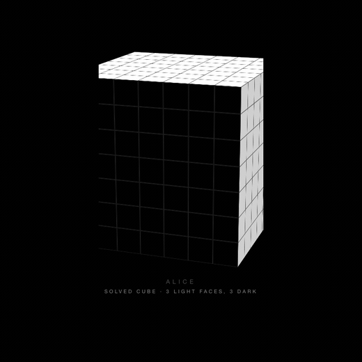
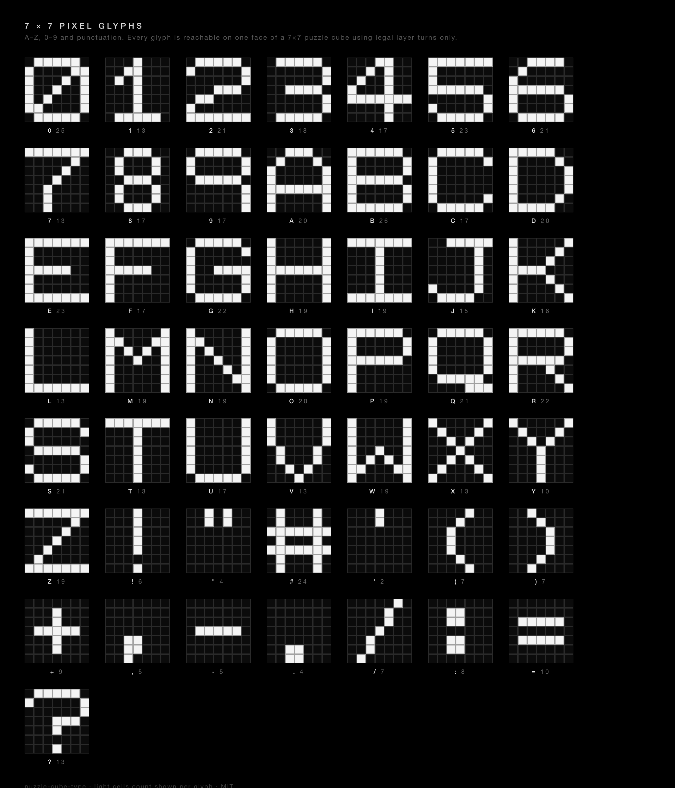

# puzzle-cube-type

A 7×7 puzzle cube that turns itself into letters.

**[Live demo →](https://aliceeeileaf19.github.io/puzzle-cube-type/)**



*Two cubes, each turning itself through its own word — `ALICEILEAF` and
`WILLIAM`. Every letter is reached by legal layer turns; the count under each
cube tracks how far through the word it has got. The orbit in the middle is the
whole point: both cubes stop, the camera swings round, and the other faces turn
out to be nothing but scattered light and dark stickers. Nothing hidden, nothing
repainted. ([full 36 s MP4](docs/demo.mp4) — the GIF is the first 17 s)*

The sticker colours are decided once and **never change**. Every letter on the
front face is reached by legal layer turns only — the same turns you could make
with your hands on a physical cube. Drag it around and you will find no trick
behind it: three faces are light, three are dark, and that is all there ever is.

31 KB of CSS and JavaScript as shipped, ~10 KB gzipped, a good part of it
comments. No dependencies, no build step, no WebGL, no canvas — just CSS 3D
transforms.

*[中文說明](README.zh-TW.md)*

---

## Why this is not a mosaic generator

Cube mosaic tools arrange a **grid of many cubes** so that, seen from the front,
they approximate a picture. This is one cube, used as a display, and the harder
constraint is that nothing is repainted:

|                          | cube-type                                  | typical mosaic tool             |
| ------------------------ | ------------------------------------------ | ------------------------------- |
| Cubes                    | one                                        | dozens to thousands             |
| Sticker colours          | fixed forever                              | assigned per target             |
| How the target is formed | a solved sequence of legal layer turns     | usually by setting colours      |
| Verifiable claim         | light-sticker count is invariant           | —                               |

That last row is the whole point. Open the console on the demo: the number of
light stickers is 147 at every instant, from the first turn to the last. A
permutation cannot create or destroy a sticker, so a constant count is proof
that the letters are being *moved* into place, not painted.

---

## How it works

### The one identity that makes it tractable

Number the front face's cells by column `i` and row `j`, both from `-3` to `3`.
Let

- `C_i` = turn the layer `x = i` (a vertical slab), which touches only **column
  i** of the front face,
- `R_j` = turn the layer `y = j` (a horizontal slab), which touches only **row
  j**.

Then consider their commutator:

```
[C_i , R_j]  =  C_i · R_j · C_i⁻¹ · R_j⁻¹
```

- A front cell in neither column `i` nor row `j` is untouched by all four
  moves.
- A cell in column `i` but not row `j` is carried off the face by `C_i` and
  carried back by `C_i⁻¹`; `R_j` never reaches where it went.
- Symmetrically for a cell in row `j` but not column `i`.

So the sequence changes **exactly one front cell — the intersection `(i, j)`**,
and leaves the other 48 alone. Verified for all 49 cells.

This is the whole solver. Given a tool that edits one cell without disturbing
the others, you can fix cells one at a time and never undo your own work.

Crucially, *whether a sequence changes only one cell is a property of the
permutation*, not of where the stickers currently sit. So the tool table is
probed once at startup (~150 ms) and is valid forever. Widening the search to
180° variants and z-layer conjugates yields **≈1200 tools of 4 or 6 moves**,
which matters: it gives each cell several different 3-cycles to draw from.

### Why three light faces and three dark

Stickers cannot move between piece-type orbits. A corner sticker only ever
reaches the four corners of a face; an edge sticker only the border; a centre
sticker only the interior. So each orbit must independently carry enough of both
colours for every glyph you want to display.

The convenient fact: **every orbit is spread evenly across the six faces**
(orbit size = cells-per-face × 6). Colouring *whole faces* therefore gives every
orbit an exact half-and-half split — no per-sticker tuning required.

Worst case over all 26 letters:

| orbit                 | stickers | front cells | max light | max dark | 3+3 faces give |
| --------------------- | -------: | ----------: | --------: | -------: | -------------: |
| corner                |       24 |           4 |     4 (E) |    4 (C) |        12 / 12 |
| edge wing, t=1        |       48 |           8 |     8 (B) |    8 (X) |        24 / 24 |
| edge wing, t=2        |       48 |           8 |     8 (B) |    8 (X) |        24 / 24 |
| edge centre           |       24 |           4 |     4 (D) |    4 (X) |        12 / 12 |
| T-centre, inner/outer |    24 ×2 |         4×2 |         2 |        4 |        12 / 12 |
| X-centre, inner/outer |    24 ×2 |         4×2 |     4 (X) |    4 (B) |        12 / 12 |
| oblique, left/right   |    24 ×2 |         4×2 |     2 (V) |    4 (B) |        12 / 12 |
| face centre           |        6 |           1 |     1 (B) |    1 (A) |          3 / 3 |

294 stickers total; 147 light and 147 dark. The hard minimum is only 41 light
and 49 dark, so this colouring has roughly 3× slack in every orbit.

> A 7×7 detail worth knowing: the 48 oblique centres split into **left-handed
> and right-handed orbits of 24 that never mix**. They must be counted as two
> separate orbits. A 5×5 has no obliques at all.

Which three faces are light is therefore purely cosmetic. The default is
`top`, `right`, `back` — chosen so the **front face is dark**: a reset cube is a
clean dark grid that letters get written onto in light pixels, while the two
faces the default camera sees are light, which is what gives the cube its
solidity.

### The solver

1. **Greedy descent.** Try all 42 single moves, take whichever most reduces the
   Hamming distance to the target, repeat while it improves. One move rewrites a
   whole row or column, so this closes most of the gap cheaply.
2. **Per-cell repair.** For each remaining wrong cell, apply a single-cell tool
   that yields the needed colour. Cells already correct cannot be disturbed.
3. **Pool shuffle.** If every 3-cycle available to a cell happens to be
   monochrome, apply a turn that provably cannot touch the front face (any `z`
   layer except `z = 3`) and try again.

A repeated letter solves in **0 moves**, because a real cube genuinely does not
need to move. Short solves are padded with front-preserving turns and re-solved,
so the cube is visibly working without disturbing the glyph.

### Making the solution shorter

Greedy descent on its own is deterministic, so simply re-running it explores
nothing. Three changes together take about a quarter off the move count:

1. **Randomised tie-breaks.** Among equally good moves, pick at random — now
   restarts actually diverge.
2. **Plateau moves.** Allow up to three distance-neutral moves to climb out of a
   local minimum instead of dropping straight into per-cell repair.
3. **Cancellation.** Turns about the same axis commute whatever layers they act
   on, so within any run of consecutive same-axis moves the order is free.
   Group the run by layer and reduce each layer's quarter turns mod 4: 0
   vanishes, 1 or 3 collapses to one move. Provably sound, and verified against
   the target anyway.

Keeping the shortest of ten such attempts:

| over 78 (state, letter) pairs | before | after   |
| ----------------------------- | -----: | ------: |
| mean moves                    |     37 |  **28** |
| median                        |     41 |  **28** |
| worst                         |     77 |  **57** |
| failures                      |      1 |   **0** |
| slowest solve                 |  33 ms | 322 ms  |

Restarts also bought robustness: the single failure the deterministic solver hit
disappeared. The cost is solve time — 10 attempts instead of 1 — which is paid
while the cube is sitting still between letters.

**This is the shortest sequence found, not a proven minimum.** Proving
minimality on a 7×7 is out of reach: the state space is astronomical and this is
pattern reachability, not solving. A weak lower bound — each move rewrites at
most 7 of the 49 cells, so at least ⌈distance/7⌉ moves are needed — sits around
4, so there is a lot of headroom left. Closing that gap is open.

---

## Verification

Everything below is reproducible from `window.CubeType` in the demo.

| check                                                          | result                    |
| -------------------------------------------------------------- | ------------------------- |
| 26 letters from 3 different states, front face equal cell for cell | 78 / 78, 0 failures   |
| 102 arbitrary 49-bit targets, density 0.2–0.8                   | 0 failures                |
| Move count over those targets                                   | mean 39.5, median 40, max 50 |
| Degenerate targets (all-light, all-dark) from 3 states          | 0 failures                |
| 140 animated transitions, model vs. target                     | 0 mismatches              |
| DOM transforms vs. internal model                              | Hamming distance 0        |
| Light-sticker count, at all times                              | 147, invariant            |

So: with three light faces and three dark, **any 7×7 black-and-white bitmap
appears to be reachable on one face using legal turns alone.** The per-orbit
counting above shows why there is no shortage of either colour; the cases above
are empirical evidence rather than a proof of reachability.


The component also self-checks at runtime. After every letter it compares the
front face against the target and `console.warn`s if a single cell is off. It
has never fired.

---

---

## The glyphs



50 glyphs: 26 letters, 10 digits, 14 punctuation marks. Regenerate the sheet with
`docs/alphabet.html`, which reads the glyph table straight out of `cube-type.js`
so it cannot drift from the shipped font.

Seven cells is not much, so several characters needed deliberate distinguishing:
`0` is slashed and `1` is serifed so neither collapses into `O` or `I`, `8` is
drawn narrow so it does not read as `B`, and `3` has no left stem at all so it
does not read as `S`. Measured across all 1225 pairs, the closest new pair is
`.` / `,` at 3 differing cells out of 49 — the same distance as `C` / `O` and
`P` / `R`, which were already in the alphabet.

Three characters were designed and then dropped rather than shipped
half-legible: **space** (an all-dark face reads as a fault, not a gap — write
words unspaced or split them across cubes), **`&`** (it came out looking like a
filled `8`, which is also in the set) and **`@`** (a ring plus an inner glyph is
two nested features at one cell each, and the sticker seams swallow them).

## Usage

```html
<link rel="stylesheet" href="cube-type.css">

<div class="cube-type">
  <div class="cube-type__block" data-word="HELLO"></div>
</div>

<script src="cube-type.js"></script>
```

Every `.cube-type__block` inside a `.cube-type` host becomes its own cube and
cycles through its `data-word`. `A`–`Z`, `0`–`9` and
`! " # ' ( ) + , - . / : = ?` are defined; anything else is ignored.

| attribute            | on            | effect                        |
| -------------------- | ------------- | ----------------------------- |
| `data-word="…"`      | `__block`     | the letters to cycle          |
| `data-labels="off"`  | `.cube-type`  | hide the word/move-count line |
| `data-reset="off"`   | `.cube-type`  | hide the reset button         |
| `data-restarts="4"`  | `.cube-type`  | solver attempts (default 10)  |

Fewer restarts means a shorter main-thread block per letter at the cost of a few
more moves — worth it when the cube is embedded in a smooth-scrolling page. See
*Making the solution shorter* for the numbers.

Interaction: **drag** to orbit, **click** for the next letter, **reset** to
return to a solved cube. `Space` (pause) and `R` (reset) are bound only when
`<body class="cube-standalone">`, so an embedded cube never steals keys from the
host page.

It pauses itself when scrolled out of view, and respects
`prefers-reduced-motion` by not animating at all.

### Knobs

In `cube-type.js`: `N` (cube order — 5 or 9 work, supply matching `GLYPHS`),
`LIGHT_FACES`, `FAST` / `TAIL` / `HOLD` (pacing), `MIN_MOVES`, and `GLYPHS`
itself. In `cube-type.css`: `--ct-s` sets one pixel and everything scales from
it.

### Reading the target from code

`bitsOf('A')` returns 49 bits row-major, and `solve(state, target)` accepts any
49-bit array. Letters are just the first consumer of a general primitive.

---

## Limitations

- **49 pixels, two colours.** Fine for letters, icons and glyphs. Photographs
  will not survive it.
- **~500 DOM nodes per cube** (218 cubelets, 294 stickers). Two cubes on a page
  is comfortable; a dozen is not. Only the turning layer animates, which is what
  keeps it cheap.
- **No physical-cube notation yet.** The solver emits `(axis, layer, direction)`
  triples. Mapping those to standard big-cube notation (`3R'`, `2U2`) so a human
  could follow along on a real 7×7 is the obvious next step and is not done.
- **Solving blocks the main thread for up to ~320 ms**, since it runs ten
  attempts and keeps the shortest. That lands while the cube is holding still
  between letters, but it will stutter a drag in progress. Lower `RESTARTS` to
  trade move count for responsiveness.
- **Colours are not themeable yet** beyond the seam variables; the light/dark
  values live in CSS rules rather than custom properties.
- Background browser tabs throttle timers, so an off-screen demo appears to
  crawl. That is the browser, not the solver.

## Prior art

Cube animation players ([Roofpig](https://github.com/larspetrus/Roofpig),
[AnimCubeJS](https://animcubejs.cubing.net/animcubejs.html)) replay notation but
do not construct patterns. Mosaic generators
([Tessellate](https://github.com/adlrwbr/Tessellate),
[Roman-/mosaic](https://github.com/Roman-/mosaic)) build pictures from grids of
cubes. Big-cube solvers ([RCube](https://github.com/ShellPuppy/RCube)) also use
commutators to shuttle centre pieces, but aim at solving rather than at
reaching a chosen pattern. I did not find prior work driving a single cube as a
typographic display under a fixed sticker set.

## Trademark

Not affiliated with, endorsed by, or connected to Rubik's Brand Ltd or Spin
Master. "Rubik's" is their trademark and is deliberately not used here; per
their [brand use guide](https://www.rubiks.com/brand-use-guide), third parties
should use generic terms such as *puzzle cube* or *magic cube*, which is what
this project does.

## License

[MIT](LICENSE) © 2026 Alice I Leaf
